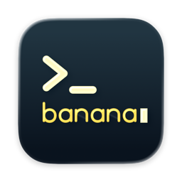
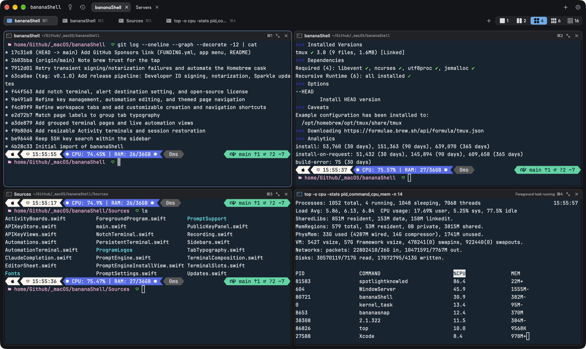
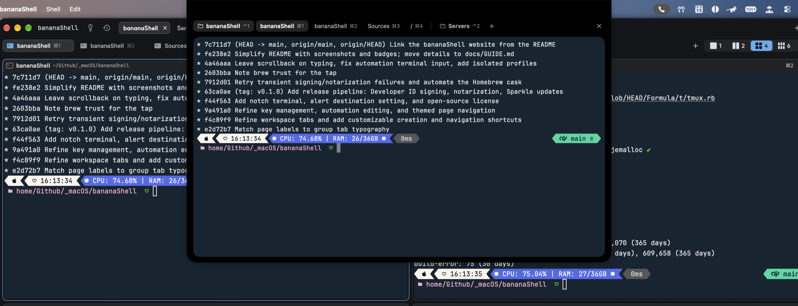

<p align="center">
  
</p>

<h1 align="center">bananaShell</h1>

<p align="center">
  A macOS terminal whose sessions survive quitting the app.<br>
  Grouped grids, a drop-down notch terminal, and alerts when Claude Code finishes.
</p>

<p align="center">
  <a href="https://decultureware.com/apps/bananashell"><b>Website</b></a>
</p>

<p align="center">
  <a href="https://github.com/howon-kim/bananaShell/releases/latest"></a>
  <a href="https://github.com/howon-kim/bananaShell/releases"></a>
  
  
  <a href="https://github.com/howon-kim/homebrew-tap"></a>
  <a href="LICENSE"></a>
</p>

<p align="center">
  
</p>

## Features

- **Persistent sessions**: shells and running processes keep going after you quit, and reconnect with your layout on the next launch.
- **Groups, pages and grids**: show 1 to 16 terminals per page and drag tabs, pages and groups between windows.
- **Notch terminal**: press <kbd>⌃</kbd><kbd>`</kbd> from any app to drop the current terminal down from the notch.
- **Claude Code alerts**: get a notch card when a Claude response completes, with a preview of the reply.
- **Automations**: record a terminal session once, then replay it on a schedule. It asks you when a prompt needs an answer.
- **Prompt themes**: built-in Powerline designs, plus Oh My Posh and Starship themes.
- **Keys**: generate SSH keys and store API keys in the macOS Keychain.

<p align="center">
  
</p>

## Install

```sh
brew install --cask howon-kim/tap/bananashell
```

Or download the `.dmg` from [Releases](https://github.com/howon-kim/bananaShell/releases/latest) and run `brew install tmux`.

Requires macOS 13 or later. Updates install automatically.
If Homebrew says the tap is untrusted, run `brew trust howon-kim/tap` first.

## Docs

- [Guide](docs/GUIDE.md): every feature and shortcut in detail
- [Releasing](docs/RELEASING.md): for maintainers

## License

[MIT](LICENSE). Third-party components are listed in [THIRD_PARTY_NOTICES.md](THIRD_PARTY_NOTICES.md).
